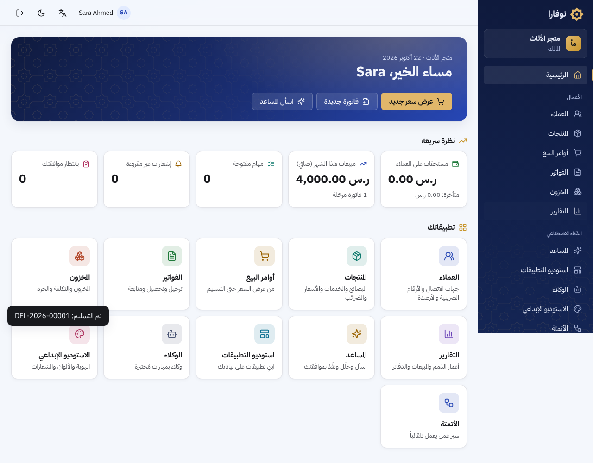

# NOVARA (اسم مؤقت)

منصة موحدة تجمع إدارة الأعمال (على غرار Odoo) مع بناء التطبيقات بالذكاء الاصطناعي، والوكلاء، والأتمتة، والتصميم.
المخطط الكامل في [`docs/PLATFORM_BLUEPRINT.md`](docs/PLATFORM_BLUEPRINT.md).

A unified platform combining an ERP-style business suite with AI app building, agents, automation and design.

## الحالة الحالية

| المرحلة | الحالة | التفاصيل |
|---|---|---|
| 1. الأساس: الحسابات، المؤسسات، الصلاحيات، العزل، التدقيق، النسخ الاحتياطي | ✅ الخلفية مكتملة | [`docs/phase-1-foundation.md`](docs/phase-1-foundation.md) |
| 2. الأعمال: العملاء، المنتجات، الفواتير والإشعارات الدائنة، دفتر الأستاذ والقوائم المالية وإقفال الدفاتر، المخزون والحجز، المبيعات، المشتريات، رمز QR للفاتورة الإلكترونية | ✅ مكتملة ([ما بقي](docs/phase-2-business.md#ما-لم-يُنجز-في-هذه-المرحلة)) | [`docs/phase-2-business.md`](docs/phase-2-business.md) |
| 3. المساعد الذكي: أدوات بصلاحيات المستخدم، موافقة على كل تغيير، ميزانية وتتبع | ✅ الخلفية مكتملة | [`docs/phase-3-assistant.md`](docs/phase-3-assistant.md) |
| 4. AI App Studio: قالب محدد، مُنشئ ذكي، إصدارات وفحوص، معاينة، نشر إنتاج بموافقة | ✅ الخلفية مكتملة | [`docs/phase-4-app-studio.md`](docs/phase-4-app-studio.md) |
| 5. الوكلاء والأتمتة: وكلاء باختبارات ونشر وحدود، ومحرك سير عمل بموافقات وإعادة محاولة | ✅ الخلفية مكتملة | [`docs/phase-5-agents-automation.md`](docs/phase-5-agents-automation.md) |
| 6. Creative Studio: ألوان بتباين مقاس، شعارات SVG متجهية حقيقية، حزم هوية، وكيل تصميم، استضافة خاصة بموافقة | ✅ الجزء الأساسي ([ما بقي](docs/phase-6-creative-hosting.md#ما-لم-يُنجز-من-المرحلة-السادسة)) | [`docs/phase-6-creative-hosting.md`](docs/phase-6-creative-hosting.md) |
| الواجهة: كل الشاشات لكل المراحل، عربية أولاً، فاتح وداكن، جوال | ✅ مكتملة ([ما بقي](docs/frontend.md#ما-لم-يُنجز-بعد-في-الواجهة)) | [`docs/frontend.md`](docs/frontend.md) · [الهوية البصرية](docs/design-identity.md) |



```
apps/web/                الواجهة: React + TypeScript + Vite
  src/pages/             الشاشات (الأعمال، المساعد، الاستوديوهات، الأتمتة، الإدارة)
  src/components/        عناصر الواجهة، الهوية (النجمة الثمانية)، الرسم البياني
  src/api/               عميل مولَّد الأنواع من OpenAPI
  e2e/                   اختبارات المتصفح (Playwright)
services/api/            FastAPI + SQLAlchemy (Python)
  novara/tenancy.py      عزل المؤسسات التلقائي في طبقة البيانات
  novara/modules/        identity · organizations · access · audit · files
                         partners · catalog · accounting · invoicing · inventory · sales · purchasing · dataio
  novara/ai/             المساعد الذكي: النماذج، الأدوات، الموافقات، الاستهلاك
  novara/studio/         App Studio: المشاريع، الإصدارات، الفحوص، المُنشئ الذكي، النشر
  novara/agents/         Agent Builder: الإصدارات، الاختبارات، النشر، التشغيل
  novara/automation/     الأحداث، سير العمل، الموافقات، المهام، الإشعارات
  novara/worker.py       عامل الأتمتة في الخلفية
  novara/creative/       Creative Studio: الألوان، الشعارات، حزم الهوية، وكيل التصميم
  novara/hosting/        طلبات الاستضافة الخاصة
  novara/ops.py          أوامر مشغلي المنصة (خارج الـ API)
  migrations/postgres/   المخطط + Row-Level Security + صلاحيات دور التشغيل
  tests/                 اختبارات العزل والصلاحيات (SQLite و PostgreSQL)
infrastructure/
  backup/                نسخ احتياطي مشفّر + التحقق من الاستعادة
  deployment/            أدوار PostgreSQL، وإعداد nginx بسياسة CSP صارمة
docs/                    المخطط ووثائق المراحل
```

## تجربتها على Railway

ملف `Dockerfile` في الجذر يبني المنصة كلها في حاوية واحدة، ولا تحتاج إلا قاعدة PostgreSQL من Railway ومتغيراً واحداً هو `DATABASE_URL`. الخطوات في [`docs/deploy-railway.md`](docs/deploy-railway.md).

## البدء السريع

```bash
cd services/api
python -m venv .venv && . .venv/bin/activate
pip install -r requirements-dev.txt
pytest
uvicorn novara.main:create_app --factory --reload   # http://localhost:8000/docs

cd ../../apps/web
npm ci
npm run dev                                         # http://localhost:5173
```

## قواعد التطوير

- كل ميزة لها اختبارات، وتغييرات قاعدة البيانات عبر `migrations/` فقط.
- كل نموذج يخص مؤسسة يرث `TenantScoped`. لا تكتب شرط `organization_id` يدويًا، ولا تستخدم `system_scope` دون سبب موثّق.
- الصلاحيات تُفرض في الخادم عبر `require(permission)`، وكل عملية حساسة تُسجَّل عبر `audit.record`.
- لا أسرار في Git، والإصدارات مثبتة في `requirements*.txt`.
- لا يُدمج كود مولّد بالذكاء الاصطناعي دون مراجعة واختبارات.
