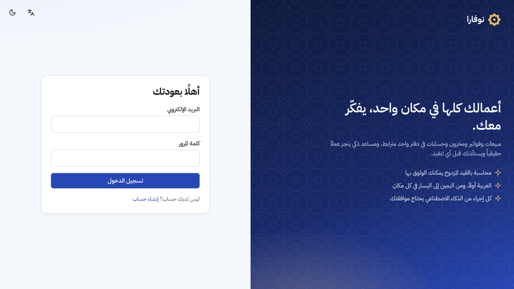
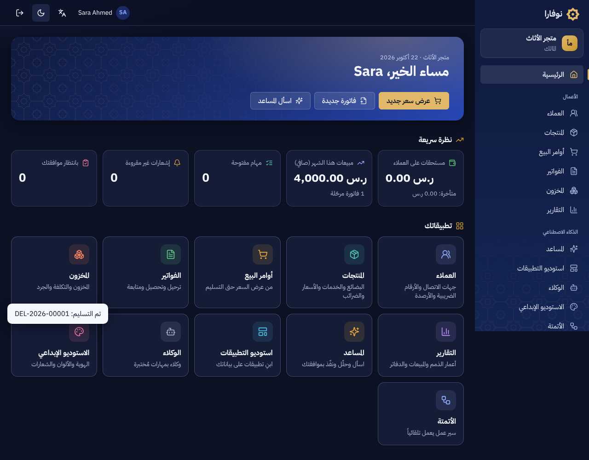
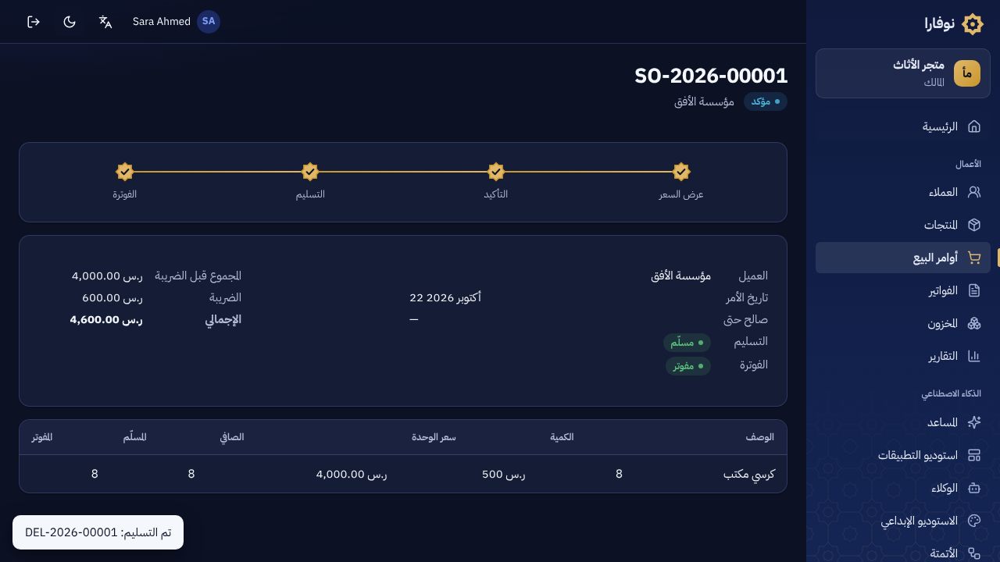
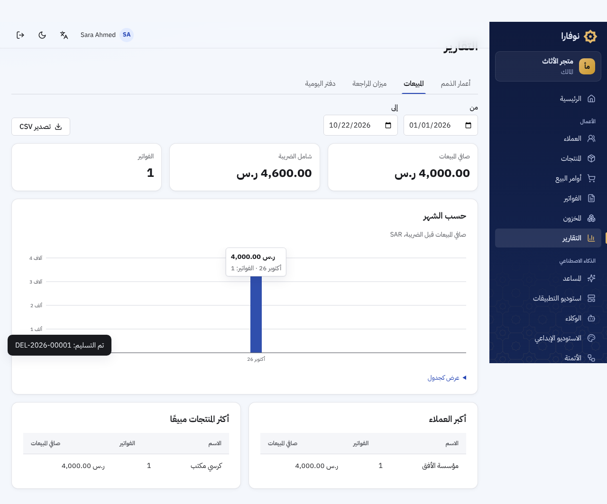
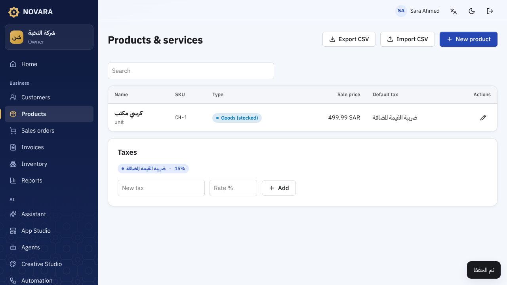
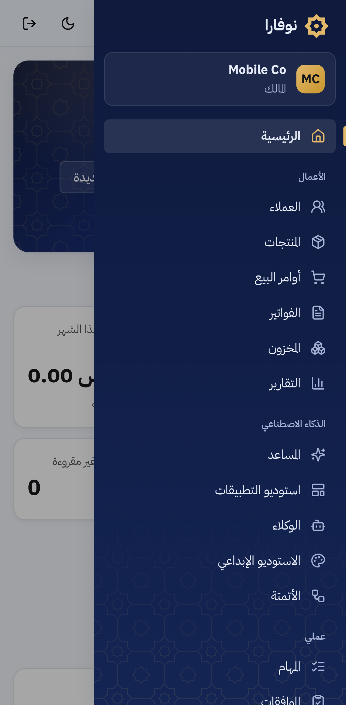

# هوية NOVARA البصرية

الهدف: واجهة بنفس جودة وترتيب الأنظمة الكبيرة (مثل Odoo)، لكن بشخصية خاصة بنا وليست تقليداً.

## الفكرة: اللازورد والذهب

- **اللازورد (Lapis) `#2747b5`** للأزرار والروابط والإجراءات. مستوحى من بلاط المساجد وزخارف المخطوطات.
- **ذهب التذهيب `#c8962d` / `#e1b76a`** للّمسات: المكان الحالي في القائمة، مراحل المستند المكتملة، الأزرار المميزة.
- **ليل لازوردي `#0f1a3d`** للقائمة الجانبية في الوضعين، وللخلفيات في الوضع الداكن بدل الرمادي المحايد.
- **النجمة الثمانية (الخاتم)** من الهندسة الإسلامية، وهي أيضاً "Nova" في الاسم. شكل واحد يُستخدم في:
  - الشعار.
  - علامات مراحل المستند.
  - الشبكة الزخرفية الخفيفة في القائمة وبطاقة الترحيب وصفحة الدخول.

## العناصر المميزة

| العنصر | ماذا يفعل | أين |
|---|---|---|
| مسار المستند | نجوم متصلة تُظهر أين وصل أمر البيع أو الفاتورة. الذهبي يعني مكتمل، واللازوردي يعني المرحلة الحالية | `components/business.tsx` (`Journey`) |
| بطاقة الترحيب | تحية بالاسم، والتاريخ، وأهم الإجراءات | `pages/Home.tsx` |
| مشغّل التطبيقات | لكل وحدة لون خاص وأيقونة على خلفية من نفس اللون، والتباين ≥ 3:1 في الوضعين | `components/nav.ts` و`.hue-*` |
| صفحة الدخول | لوحة فنية بالشبكة الزخرفية بجانب النموذج | `pages/Auth.tsx` |

## القواعد

- **مصدر الألوان:** تأتي من الاستوديو الإبداعي للمنصة نفسها:
  ```
  npm run gen:tokens -- "#2747b5" "#c8962d"
  ```
  وتُفحص بمعايير WCAG.
- **ما يُعرَّف في `app.css`:** ألوان القائمة الليلية، وألوان الوحدات، والوضع الداكن اللازوردي. نسب التباين مكتوبة بجانب كل منها.
- **العربية أولاً:** خصائص منطقية (inline-start/end) في كل مكان، فلا يحتاج RTL وLTR إلى ملفّي تنسيق منفصلين.
- **الأرقام:** أرقام لاتينية، والمبالغ تُنسَّق بـ BigInt بلا أي تقريب عائم.

## لقطات

| | |
|---|---|
|  |  |
|  |  |
|  |  |
|  |  |
