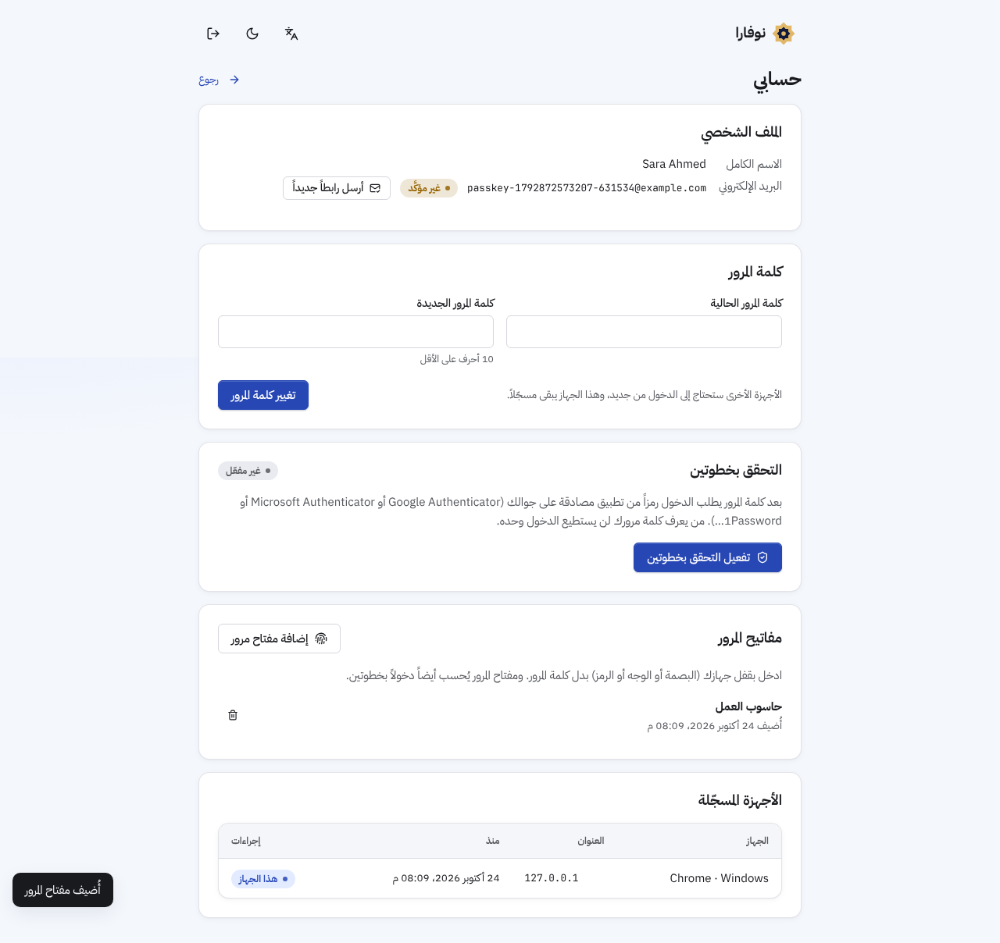

# الواجهة (apps/web)

واجهة React بالعربية أولاً، تعمل فوق الـ API نفسه الذي تختبره الخلفية، دون أي منطق أعمال مكرر.
الهوية البصرية موثقة في [`design-identity.md`](design-identity.md).

## التشغيل

```bash
# الخادم (من services/api)
uvicorn novara.main:create_app --factory --reload           # http://localhost:8000

# الواجهة (من apps/web)
npm ci
npm run dev                                                 # http://localhost:5173 (يمرّر /api إلى الخادم)
```

| الأمر | ماذا يفعل |
|---|---|
| `npm run typecheck` | فحص الأنواع (TypeScript strict) |
| `npm test` | اختبارات الوحدة (Vitest): الحساب العشري، الترجمة، القائمة، المحور، المبالغ، إعادة قراءة المستخدم بعد تغييره |
| `npm run e2e` | اختبارات المتصفح (Playwright) على الخادم الحقيقي وقاعدة SQLite مؤقتة |
| `npm run gen:api` | يولّد `src/api/schema.d.ts` من مخطط OpenAPI للخادم (يفشل CI إن لم يكن محدّثاً) |
| `npm run gen:tokens` | يولّد ألوان الواجهة من الاستوديو الإبداعي للمنصة |
| `npm run build` | بناء الإنتاج في `dist/` (يُقدَّم عبر nginx بسياسة CSP صارمة) |

## الشاشات

| القسم | الشاشات |
|---|---|
| الأساس | الدخول (مع خطوة التحقق الثانية، أو بمفتاح مرور) والتسجيل، استعادة كلمة المرور، تأكيد البريد، قبول الدعوة، حسابي (كلمة المرور، التحقق بخطوتين برمز QR ورموز استرداد، مفاتيح المرور، الأجهزة المسجّلة)، المؤسسات، الرئيسية |
| الأعمال | العملاء والمنتجات (مع استيراد CSV بفحص مسبق)، أوامر البيع (عرض سعر ← تأكيد ← تسليم ← فوترة، مع الكمية المحجوزة، وطلبات المواقع المنشورة تتحول إلى عروض أسعار)، الفواتير (بعملة أخرى بسعر صرف مع الإجمالي والمستحق بعملة المؤسسة، ترحيل، حالة الفاتورة الإلكترونية لدى الهيئة مع تنزيل XML وإعادة الإرسال، دفعات، رابط دفع إلكتروني يُنسخ للعميل وتتحدث حالته وحدها حين يؤكد المزوّد الدفع، إشعار دائن مع إرجاع للمخزون، إلغاء بقيد عكسي، طباعة مع رمز QR للفاتورة الإلكترونية)، الإشعارات الدائنة (رد المبلغ، طباعة)، المشتريات (الموردون، أوامر الشراء ← استلام ← فاتورة مورد ← دفع، وفواتير مباشرة للمصروفات، وإشعارات الموردين الدائنة مع إعادة البضاعة واستلام ما يرده المورد)، المخزون (المحجوز والمتاح)، المشاريع (مهام، ساعات يسجلها الفريق، الميزانية بالساعات، فوترة الساعات)، الحجوزات (أسبوع بمنطقة الحجوزات الزمنية، طلبات المواقع للتأكيد أو الرفض، حجز مباشر من الأوقات المتاحة أو خارج ساعات العمل، الخدمات وساعات العمل الأسبوعية)، الموارد البشرية (إجازاتي ورصيدها مع المرحّل والمكتسب شهرياً، ونصف يوم صباحاً أو مساءً، وتسجيل الحضور والانصراف وساعات الشهر؛ طلبات تنتظر قرارك، الموظفون، الحضور والإضافي لكل موظف في الشهر مع سجلاته وتصحيحها واعتماد الإضافي، من في إجازة، الأقسام وأنواع الإجازات والعطلة الأسبوعية ويوم العمل ومنطقته الزمنية والعطل الرسمية)، الرواتب (مسيرات الأشهر بالحساب والترحيل والصرف والإلغاء وملف التحويل البنكي، ورواتب الموظفين بالبنود والآيبان والاشتراكات وطريقة دفع الساعات الإضافية، والاشتراكات؛ وقسائم راتبي في صفحة الإجازات)، المستندات (رفع ملفات PDF وWord والنصوص، والبحث داخلها بمقاطع مرتبة، وحالة قراءة كل ملف)، المحاسبة (الإقفال الشهري مع المسودات القائمة وإعادة الفتح بسبب، دفتر اليومية مع فلتر المصدر، قيود يدوية متوازنة وعكسها، دليل الحسابات، إقفال السنة في الأرباح المحتجزة)، التقارير (الأرباح والخسائر، الميزانية العمومية، أعمار الذمم المدينة والدائنة، المبيعات مع رسم شهري، ميزان المراجعة، تصدير CSV، إقفال الدفاتر) |
| الذكاء الاصطناعي | المساعد (رد يُبث أثناء كتابته، محادثات، بطاقات إجراءات تنتظر الموافقة، «ما يتذكره المساعد»)، استوديو التطبيقات (ملفات، منشئ ذكي، فروقات، إصدارات وفحوص، معاينة، إنتاج بموافقة، نطاقات خاصة تُثبت بسجل DNS، مفاتيح بيانات تتيح للموقع المنشور قراءة الكتالوج وإرسال طلبات الشراء)، الوكلاء (بناء مع ملفات المعرفة، اختبارات، نشر، تشغيل، سجل)، الاستوديو الإبداعي (هويات، معاينة حيّة فاتح/داكن، شعارات SVG/PNG، وكيل تصميم، تطبيق الهوية على تطبيق)، الأتمتة (منشئ سير عمل مرئي مع جدولة كل ساعة/يوم/أسبوع/شهر أو بتعبير cron مع معاينة مواعيد التشغيل القادمة، وخطوة Webhook، وعنوان Webhook وارد يطلق سير العمل ويمكن اشتراط توقيعه، سر التوقيع، عمليات التشغيل) |
| عملي | المهام، الموافقات، الإشعارات (مع عدّادات حيّة في القائمة) |
| الإدارة | الأعضاء (إضافة مباشرة، دعوة بالبريد، دعوات بانتظار القبول، من فعّل التحقق بخطوتين)، الأدوار، سجل التدقيق، المؤسسة (ومنها الفوترة الإلكترونية للمرحلة الثانية: بيانات البائع وبيئة الهيئة وربط الجهاز برمز التحقق وإيقافه، ومنها المدفوعات الإلكترونية بمفاتيح لا تُعرض بعد حفظها وعنوان Webhook للنسخ، وإلزام الأعضاء بالتحقق بخطوتين)، إعدادات الذكاء الاصطناعي (تشغيل/إيقاف، ميزانية، حد لكل عضو، نموذج لكل مهمة، الاستهلاك)، الاستضافة (عرض سعر، طلب، موافقة بكتابة السعر نفسه) |

## مبادئ التنفيذ

- **الصلاحيات:** القائمة والأزرار تُخفى حسب صلاحيات المستخدم، لكن الخادم هو من يفرضها دائماً. الواجهة لا تعتبر الإخفاء حماية.
- **ردود المساعد منسّقة بأمان:** مجموعة صغيرة من Markdown (فقرات، عناوين، عريض، مائل، كود، قوائم، جداول، روابط http/https فقط) تُبنى عناصر React مباشرة ولا تمر عبر HTML أبداً، فلا يستطيع نص في الرد حقن وسوم أو سكربت (`lib/markdown.tsx`).
- **المال:** المبالغ نصوص عشرية من الخادم وتُنسَّق بـ BigInt، بلا أي تحويل إلى float.
  - **مجاميع المحرر:** تقديرية وتتبع قواعد التقريب في الخادم نفسها (`lib/decimal.ts`)، والرقم النهائي ما يعيده الخادم.
- **منع التكرار:** الدفعات والتسليم واستلام المخزون ترسل `Idempotency-Key` ثابتاً لكل نية مستخدم، فإعادة النقر لا تدفع أو تشحن مرتين.
- **الذكاء الاصطناعي لا ينفّذ وحده:** أي إجراء يغيّر البيانات يظهر بطاقةً بزرّي موافقة ورفض، وينفَّذ بصلاحيات من يوافق عليه في لحظة الموافقة.
- **العربية والاتجاه:** خصائص CSS منطقية في كل مكان، و`<bdi>` و`dir="auto"` للنصوص المختلطة، وأرقام لاتينية وتقويم ميلادي في التواريخ.
- **الوصول (Accessibility):** كل حقل مربوط بتسميته ورسائل خطئه (`aria-describedby`)، ونوافذ حوار أصلية، وتنقل كامل بلوحة المفاتيح، وتباين ألوان مفحوص.
  - **الرسم البياني:** له تلميح عند المرور والتركيز، وجدول بديل لنفس البيانات.

## الاختبارات من البداية للنهاية

`playwright.config.ts` يشغّل الخادم الحقيقي عبر `tests/e2e_app.py`، وهو الخادم نفسه لكن مع بديل حتمي للنموذج اللغوي بدل استدعاء خدمة خارجية، وصندوق بريد في الذاكرة تقرأ منه الاختبارات الروابط المرسلة.
تغطي الاختبارات (33 اختباراً، منها اختبار على مقاس جوال):
- التسجيل والعزل حسب الدور.
- تأكيد البريد واستعادة كلمة المرور من روابط البريد.
- تفعيل التحقق بخطوتين والدخول برمز ثم برمز استرداد ثم إيقافه.
- إقفال الشهر الماضي وفيه مسودة (تظهر قبل التأكيد)، ثم إعادة فتحه بسبب يظهر مع الشهر.
- رفع ملف PDF عربي وملف نصي إلى المستندات والبحث داخلهما، ثم يجيب المساعد من المقطع، ووكيل معرفته السياسة وحدها لا يرى الملف الآخر.
- إضافة مفتاح مرور من صفحة الحساب (بمصادِق Chromium الافتراضي) ثم الدخول به دون كلمة المرور.
- مؤسسة تلزم بالتحقق بخطوتين: عضو لديه مفتاح مرور يدخل بكلمة المرور وحدها فيُمنع، وتُقفل في حسابه إضافة طرق الدخول وحذفها، ثم يدخل بمفتاح المرور من صفحة المنع فيصل إلى المؤسسة.
- دعوة شخص بلا حساب حتى انضمامه بالدور المدعو.
- دورة الشراء: مورد ← أمر شراء ← استلام ← فاتورة مورد بسعر المورد الفعلي ← دفع، ثم الذمم الدائنة والميزانية.
- إشعار دائن على فاتورة مدفوعة ورد المبلغ، والأرباح والخسائر، ورمز QR، وإقفال الدفاتر.
- فاتورة بالدولار بسعر صرف تُقيَّد بالريال، ودفعتها بسعر آخر يظهر معها فرق الصرف.
- إشعار مدين على فاتورة مرحّلة بسبب وبند، يُرقَّم ⁦DN-2026-00001⁩ ويظهر في الفاتورة الأصلية.
- جلب الأسعار من البنك المركزي الأوروبي: اختيار العملات وجلبها يدوياً (ببديل عن خدمة البنك في الاختبار)، وبقاء السعر المُدخل يدوياً.
- سعر صرف محفوظ ليوم، ثم إعادة تقييم فاتورة بالدولار في نهاية الشهر بفرقها غير المحقق وإلغاؤها، والسعر المحفوظ يُقترح في فاتورة جديدة بالدولار.
- الفوترة الإلكترونية: الرقم الضريبي وبيانات البائع، ثم ربط الجهاز برمز التحقق مع هيئة بديلة تصدر شهادات حقيقية وتتحقق من كل توقيع، ثم ترحيل فاتورة فتظهر «أُبلغت الهيئة» ورمز QR للمرحلة الثانية.
- الدفع الإلكتروني بالمزوّد التجريبي: يظهر عنوان Webhook عند اختيار Stripe أو ميسّر أو هايبر باي (ورمز الوصول يُحفظ ويظهر مختصراً)، ثم رابط دفع لفاتورة يفتحه العميل في نافذة أخرى ويدفع، فتصبح الفاتورة مدفوعة دون إعادة تحميل وتظهر الدفعة «إلكترونياً».
- إشعار دائن من مورد يعيد بضاعة للمخزون ويخصم من فاتورته.
- سنة مالية تبدأ في أبريل من إعدادات المؤسسة، ثم قيد يدوي متوازن، وحساب جديد، وإقفال السنة في آخر يومها المقترح، وعكس القيد.
- مشروع بمهمة وساعات مسجلة، ثم فوترة الساعات القابلة للفوترة.
- الرواتب: اشتراك تأمينات، وراتب موظف ببندين خاضعين للاشتراك وآيبان، ثم مسير الشهر بصافيه الصحيح، وترحيله وصرفه، وقسيمة الراتب في صفحة الموظف.
- حماية الأجور (الإمارات): رقم المنشأة ورمز توجيه بنكها، والرقم الشخصي ورمز التوجيه للموظف، ثم تنزيل ملف SIF لمسير مرحّل والتحقق من سطريه.
- الحضور والإضافي: طريقة دفع الساعات الإضافية بنظام العمل السعودي، وتسجيل الحضور والانصراف، وثماني ساعات يوم جمعة تُدخلها الموارد البشرية وتُعتمد، ثم مسير الشهر يدفعها (350.00 لأجر 7,500 أساسيه 6,000) وتظهر «مدفوع» بعد الترحيل.
- نهاية الخدمة: قواعد السعودية، ومخصص المسير (شهر عن سنتين)، ثم تسوية استقالة بثلث المكافأة وبدل خمسة أيام إجازة، وترحيلها وصرفها، وآخر يوم في ملف الموظف.
- قسم ونوع إجازة وموظف مربوط بعضو، ثم يطلب الموظف إجازة ويوافق عليها مدير القسم ويتغير رصيده.
- مؤسسة تُلزم بالتحقق بخطوتين: العضو يُطلب منه تفعيله قبل الدخول، ولا يستطيع إيقافه بعدها.
- رد المساعد يُبث، وملاحظة تُحفظ بعد الموافقة فقط وتُحذف.
- سير عمل أسبوعي بخطوة Webhook، وسر التوقيع، وحد الذكاء الاصطناعي لكل عضو.
- نظام آخر يطلق سير عمل عبر عنوانه (Webhook وارد) ثم يُستبدل العنوان، ثم يُشترط التوقيع فيُرفض الاستدعاء غير الموقّع ويُقبل الموقّع، وجدول كل ساعة، وجدول cron يُرفض فيه التعبير الأكثر تكراراً من 5 دقائق ثم تظهر مواعيده القادمة.
- دورة البيع كاملة حتى ميزان المراجعة.
- استيراد CSV.
- موافقة المساعد على إنشاء عميل.
- موافقات سير العمل والمهام والإشعارات.
- إعدادات الذكاء الاصطناعي.
- الهوية والشعار.
- استوديو التطبيقات حتى النشر للإنتاج مع صورتي الصفحة على شاشة كبيرة وهاتف من الفحص في المتصفح، ومفتاح بيانات يقرأ به الموقع الكتالوج ثم يُوقف.
- الدفع في الموقع: مفتاح بنطاق الدفع، ثم طلب من الموقع بـ ⁦pay: true⁩ يظهر «بانتظار الدفع» في أوامر البيع، ويدفع الزائر في صفحة المزوّد التجريبي، فتظهر الفاتورة مدفوعة ويختفي الطلب من قائمة الانتظار.
- نطاق خاص لموقع: تظهر سجلات DNS المطلوبة، ويفشل التحقق قبل نشر السجل ثم ينجح بعده.
- طلب شراء من موقع منشور يظهر في المبيعات ويتحول إلى عرض سعر. الطلب بلا تحقق من البشر يُرفض، ويُقبل بعد حلّه بسكربت `proof.js` الحقيقي في المتصفح (وكذلك طلب الحجز).
- خدمة وساعات عمل، ثم يطلب موقع منشور موعداً فيؤكده الفريق، ويحجز الفريق شخصاً آخر في وقت متاح.
- الوكلاء.
- منشئ سير العمل.
- الاستضافة.

## تحسينات أُنجزت بعد الإصدار الأول

- **محرر كود حقيقي (CodeMirror 6):** تلوين HTML وCSS وJS وJSON، وبحث، وإكمال تلقائي، وCtrl+S للحفظ، ومعاينة سريعة لنسخة العمل.
- **تحميل حسب الحاجة:** كل قسم يُحمَّل عند فتحه. الحزمة الأولى انخفضت من 488KB إلى 330KB (من نحو 140KB إلى 106KB مضغوطة).
- **ملاحظات الألوان وسجل التدقيق مترجمة:** يعيد الخادم تعديلات الألوان كبيانات تكتبها الواجهة بلغة المستخدم، وكل إجراء في سجل التدقيق له اسم مفهوم.
- **إشعارات فورية:** تصل عبر Server-Sent Events من `GET /orgs/{id}/live`.
  - يرسل الخادم العدّادات عند تغيّرها، ويظهر تنبيه لكل إشعار جديد.
  - البث يتحقق من الجلسة والعضوية في كل دورة.
  - إعداد nginx يمرّر الأحداث دون تخزين مؤقت.
- **ثغرات الحزم:** تحديث Vite 7 وVitest 5 وReact Router 7، ونتيجة `npm audit` الآن صفر.

- **تطبيق قابل للتثبيت (PWA):** ملف `manifest.webmanifest` بالعربية (RTL) وأيقونات بمقاسات 192 و512 وأيقونة قابلة للقص (maskable) وأيقونة Apple، فيُثبَّت التطبيق على الجوال وسطح المكتب ويفتح بنافذته الخاصة على قائمة المؤسسات.
  - عامل الخدمة `sw.js` لا يخزّن أي بيانات من الخادم: البيانات تأتي من الخادم دائماً. يخزّن صفحة «لا يوجد اتصال» وحدها، فيراها من يفتح التطبيق بلا إنترنت بدل خطأ المتصفح.
- **إشعارات الجهاز (Web Push):** كل إشعار يُنشأ لعضو (طلب إجازة، طلب حجز، دفعة إلكترونية، خطوة إشعار في سير عمل أو فشله...) يصل أيضاً إلى أجهزته التي فعّلت الإشعارات، حتى والتطبيق مغلق. الضغط على الإشعار يفتح صفحة الإشعارات في المؤسسة.
  - يُفعَّل لكل جهاز من صفحة «حسابي» (بطاقة «الإشعارات على هذا الجهاز»)، مع زر إشعار تجريبي وإيقاف.
  - التشفير حسب RFC 8291 (`aes128gcm`) والتوقيع بمفاتيح VAPID (RFC 8292)، مكتوبان في `novara/push.py` بمكتبة `cryptography` وحدها ومختبران بمثال RFC 8291 نفسه.
  - يُرسل بعد حفظ الإشعار في القاعدة فقط (لا شيء عند التراجع)، وفي الخلفية فلا يبطئ الطلب. الجهاز الذي ألغى اشتراكه (404 أو 410 من خدمة الإشعارات) يُحذف تلقائياً.
  - الاشتراك يُقبل فقط لعناوين خدمات الإشعارات المعروفة عبر https (Google وMozilla وApple وMicrosoft)، فلا يمكن استخدامه لجعل الخادم يتصل بعنوان داخلي. يمكن إضافة مضيف آخر بـ `NOVARA_PUSH_HOSTS`.
  - المفتاح: `NOVARA_VAPID_PRIVATE_KEY` (PEM أو 32 بايت base64url) و`NOVARA_VAPID_SUBJECT` (مثل `mailto:ops@example.com`). في التطوير يُنشأ مفتاح في مجلد التخزين تلقائياً، وفي الإنتاج دون مفتاح تبقى الإشعارات معطلة وتقول البطاقة ذلك. تغيير المفتاح يُبطل اشتراكات الأجهزة الحالية.

## ما لم يُنجز بعد في الواجهة

- **تطبيق جوال أصلي:** التطبيق القابل للتثبيت يغطي الجوال، لكن لا يوجد تطبيق في متجري Apple وGoogle. على iPhone تعمل الإشعارات بعد إضافة التطبيق للشاشة الرئيسية فقط (iOS 16.4 فأحدث)، كما تشترط Apple.
- **العمل دون اتصال:** صفحة «لا يوجد اتصال» فقط. لا قراءة للبيانات ولا إدخال لها دون إنترنت، عن قصد: الفواتير والمخزون تحتاج الخادم ليبقى الرقم التسلسلي والرصيد صحيحين.

## لقطات

| | |
|---|---|
|  |  |
|  |  |
|  |  |
|  |  |
|  |  |
|  |  |
|  |  |
|  |  |
|  |  |
|  |  |
|  |  |
|  |  |
|  | |
